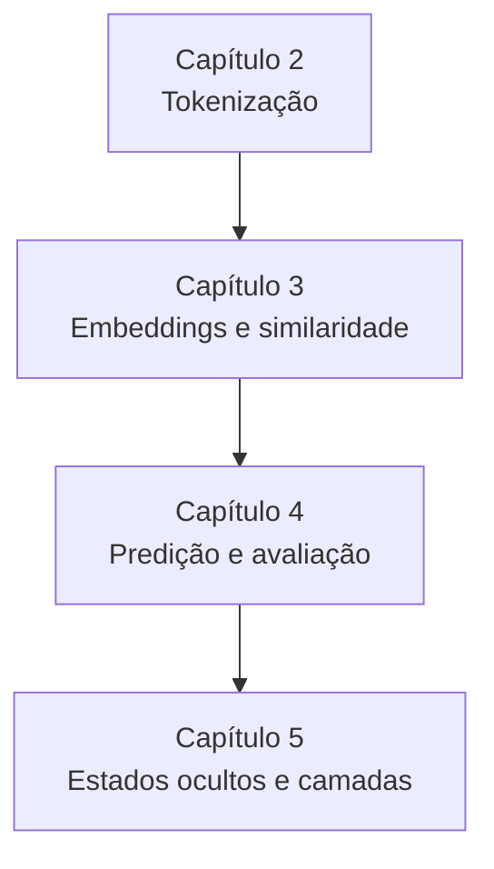

# ML para Entender LLMs

Repositório de estudos baseado no livro *50 ML Projects to Understand LLMs*, de Mike X Cohen. A proposta é compreender o funcionamento dos modelos de linguagem por meio de experimentos em Python, análise de dados e visualização de suas representações internas.

## Objetivos

- Compreender como textos são convertidos em tokens e representações vetoriais.
- Investigar relações semânticas e padrões nos embeddings.
- Explorar a predição de tokens e a avaliação de modelos de linguagem.
- Analisar como as representações se comportam entre as camadas de um transformer.
- Conectar conceitos de aprendizado de máquina à investigação prática de LLMs.

## Mapa de estudos

## Conceitos por capítulo

| Capítulo | Foco do estudo | Principais conceitos |
| --- | --- | --- |
| **2 — Tokenização** | Investigar a representação de textos e suas diferenças entre idiomas. | Caracteres, palavras, subpalavras, bytes, vocabulário e compressão. |
| **3 — Embeddings e similaridade** | Explorar a geometria e as relações semânticas das representações vetoriais. | Similaridade de cosseno, distância euclidiana, grafos, comparação de representações, eixos semânticos e analogias. |
| **4 — Predição e avaliação** | Entender a escolha do próximo token e analisar o desempenho dos modelos. | Softmax, temperatura, amostragem, acurácia, função de perda, perplexidade, regressão e benchmarks. |
| **5 — Estados ocultos e camadas** | Iniciar a investigação das representações internas ao longo do modelo. | Extração de estados ocultos e similaridade dentro e entre camadas. |

O material atual está organizado em `chapter_2/`, `chapter_3/` e `chapter_4/`, com um notebook do capítulo 5 na raiz. O repositório está em construção e será ampliado conforme o avanço dos estudos.

## Referência principal

Mike X Cohen. *50 ML Projects to Understand LLMs: Investigate Transformer Mechanisms Through Data Analysis, Visualization, and Experimentation*.

[Repositório oficial do livro e notebooks de referência](https://github.com/mikexcohen/ML4LLM_book). Os materiais deste repositório partem dos notebooks do autor, cuja identificação é preservada nos arquivos.
