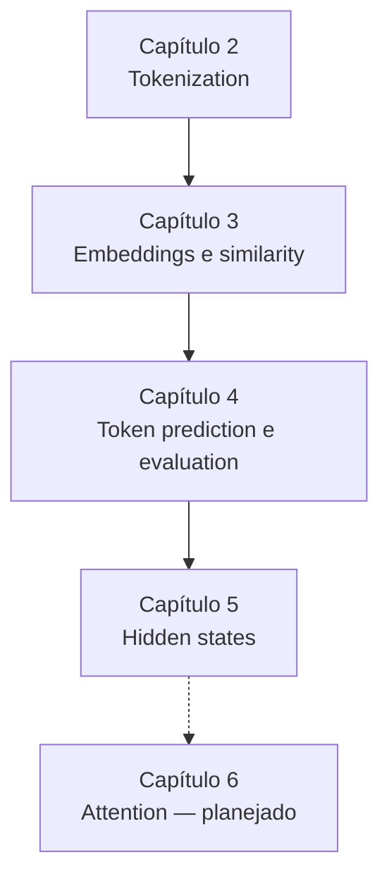

# ML para Entender LLMs

Repositório de estudos baseado no livro *50 ML Projects to Understand LLMs*, de Mike X Cohen. A proposta é compreender o funcionamento dos modelos de linguagem por meio de experimentos em Python, análise de dados e visualização de embeddings, hidden states e mecanismos de attention.

## Objetivos

- Compreender como textos são convertidos em tokens e representações vetoriais.
- Investigar relações semânticas e padrões nos embeddings.
- Explorar a predição de tokens e a avaliação de modelos de linguagem.
- Analisar hidden states entre camadas e testar os efeitos de intervenções nas ativações.
- Investigar mecanismos de attention e o papel das attention heads.
- Conectar conceitos de aprendizado de máquina à investigação prática de LLMs.

## Mapa de estudos

## Conceitos por capítulo

| Capítulo | Foco do estudo | Principais conceitos |
| --- | --- | --- |
| **2 — Tokenization** | Investigar a representação de textos e suas diferenças entre idiomas. | Caracteres, palavras, subpalavras, bytes, vocabulário e compressão. |
| **3 — Embeddings e similarity** | Explorar a geometria e as relações semânticas das representações vetoriais. | Cosine similarity, distância euclidiana, grafos, comparação de representações, eixos semânticos e analogias. |
| **4 — Token prediction e evaluation** | Entender a escolha do próximo token e analisar o desempenho dos modelos. | Softmax, temperatura, amostragem, acurácia, loss, perplexity, regressão e benchmarks. |
| **5 — Hidden states** | Comparar ativações entre tokens e camadas e investigar seu papel nas predições. | Cosine similarity, residual connections, hooks, ruído e escalonamento de ativações, dimensionalidade efetiva, redução de dimensionalidade, sentiment analysis com decision trees, logit lens e activation patching. |
| **6 — Attention (planejado)** | Investigar como os mecanismos de attention relacionam tokens e como cada head contribui para o comportamento do modelo. | Queries, keys e values (QKV), attention heads, análise de ativações, hooks, head silencing e activation patching. |

O material atual está organizado em `chapter_2/`, `chapter_3/`, `chapter_4/` e `chapter 5/`. O capítulo 6 está previsto na trilha; sua descrição segue os [notebooks oficiais do capítulo](https://github.com/mikexcohen/ML4LLM_book/tree/main/chapter_6). O repositório está em construção e será ampliado conforme o avanço dos estudos.

## Referência principal

Mike X Cohen. *50 ML Projects to Understand LLMs: Investigate Transformer Mechanisms Through Data Analysis, Visualization, and Experimentation*.

[Repositório oficial do livro e notebooks de referência](https://github.com/mikexcohen/ML4LLM_book). Os materiais deste repositório partem dos notebooks do autor, cuja identificação é preservada nos arquivos.
